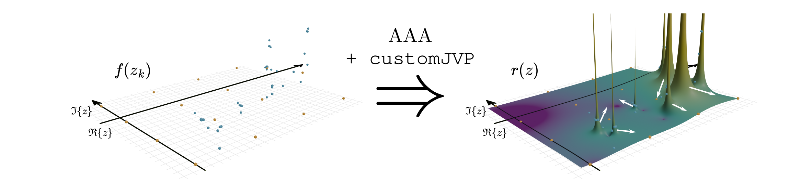

# diffaaable 1.4.0

`diffaaable` is a JAX differentiable version of the AAA algorithm. The derivatives are implemented as custom Jacobian-vector products (JVPs) following [^1].
A detailed derivation of the used matrix expressions is provided in the appendix of [^2].
Under the hood `diffaaable` uses the AAA implementation of [`baryrat`](https://github.com/c-f-h/baryrat).
Additionally the following application specific extensions to the AAA algorithm are included:

- **Adaptive**: Adaptive refinement strategy (called *Iterative Sample Refinement* (ISR) in the corresponding paper) to minimize the number of function evaluations needed to precisely locate poles within some domain
- **Vectorial**: AAA algorithm acting on vector valued functions $\mathbf{f}(z)$ as presented in [^3].
- **Tensor**: Like Vectorial, but accepts tensor-valued functions $\mathbf{F}(z)$ of arbitrary shape, e.g. to obtain a joint pole-expansion of a T-matrix [^5]. Preferred over Vectorial.
- **Lorentz**: Variant that enforces symmetric poles around the imaginary axis.
- **Selective Refinement**: Use a divide-and-conquer scheme to capture many poles simultaneously and accurately, by limiting the number of poles per AAA solve. Suggested in [^4].

## Installation
to install `diffaaable` run
`pip install diffaaable`

## Usage
Please refer to the [quickstart tutorial](docs/usage.md)

## Contributing
Feel free to open issues and/or PRs.

User facing changes are recorded with [towncrier](https://towncrier.readthedocs.io):
add a one-line fragment to `.changelog.d/`, named `<PR number>.<type>.md`
(or `+<name>.<type>.md` without a PR), where `<type>` is one of `added`,
`changed`, `performance`, `fixed`, `deprecated`, `removed` or `security`, e.g.
`towncrier create -c "Faster set_aaa." +faster-set-aaa.performance.md`.

## Citation
When using this software package for scientific work please cite the associated publication [^2].
When using the tensor-valued AAA (`tensor_aaa`), e.g. for pole-expansions of T-matrices, please also cite [^5].

+++

[^1]: https://arxiv.org/pdf/2403.19404
[^2]: "A framework to compute resonances arising from multiple scattering", https://doi.org/10.1002/adts.202400989
[^3]: https://doi.org/10.1093/imanum/draa098
[^4]: https://doi.org/10.48550/arXiv.2405.19582
[^5]: "Pole-Expansion of the T-Matrix Based on a Matrix-Valued AAA-Algorithm", ACS Photonics 13, 5291 (2026), https://doi.org/10.1021/acsphotonics.6c00436
